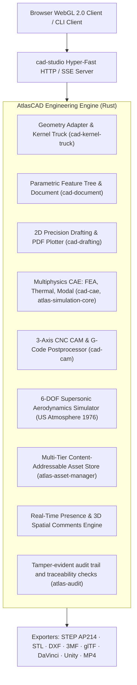

# AtlasCAD: Next-Generation Autonomous Engineering & Cloud-Native CAD Ecosystem

[](https://github.com/Sanjay-Program/atlascad/actions/workflows/ci.yml)
[](https://www.rust-lang.org/)
[](LICENSE)
[](#security-and-safety)
[-success.svg)](#testing-and-verification)
[](#testing-and-verification)

AtlasCAD is a modern, high-performance, local-first engineering workspace built in memory-safe Rust with WebGL 2.0 visualization. It unites parametric 3D B-Rep CAD, precision 2D drafting, multiphysics engineering simulation (FEA, thermal, modal, chemical reacting flows), 3-axis CNC CAM, an interactive 6-DOF aerodynamic flight physics simulator, a content-addressed multi-tier asset store, and real-time multi-user collaboration.

Designed as an enterprise-grade alternative to legacy CAD suites (AutoCAD, Autodesk Inventor, SolidWorks, Onshape), AtlasCAD eliminates multi-gigabyte client installs, proprietary file lock-in, and costly network seat licenses.

---

## 1. Why AtlasCAD: Enterprise Comparison vs Legacy CAD

| Feature / Capability | Legacy CAD (AutoCAD / Inventor / SolidWorks) | AtlasCAD Enterprise Workspace |
| :--- | :--- | :--- |
| **Annual Seat Cost** | **\$2,000 – \$5,500+ / user / year** | **\$129 / yr (Pro) · \$349 / yr (Team) · Custom Enterprise** |
| **Installation & Footprint** | 15 GB – 40 GB desktop download; slow licensing service | **Zero-install WebGL 2.0 browser app** or lightweight single-binary CLI (<35 MB) |
| **Asset Ecosystem** | Siloed local directories or proprietary Vault server; no open community forking | **Universal Multi-Tier Asset Store**: Public Community, Team Org & Private Confidential assets with 1-click forking |
| **Parametric Component Reuse** | Rigid standard parts; editing breaks downstream assembly links | **Content-Addressed Parametric Schemas**: FNV-1a / SHA-256 hashes with customizable exposed variables |
| **Real-Time Collaboration** | File checkout locks whole document; prevents simultaneous design & review | **Fine-Grained Optimistic Entity Leases**: Simultaneous orbit, inspection, simulation, and modeling with live presence |
| **Design Review Markups** | External PDFs, spreadsheets, and emails disconnected from CAD coordinates | **3D Spatial Review Pins**: Threaded comments anchored directly to 3D surface coordinates $[X,Y,Z]$ |
| **Multiphysics CAE & CAM** | Sold as expensive separate add-on packages (\$3k–\$10k/seat) | **Built-in Multiphysics**: Linear static FEA, modal vibration, thermal conduction, multi-species CFD & 3-axis G-code CAM |
| **Aerospace Simulation** | Requires separate expensive CFD tools (ANSYS Fluent / Star-CCM+) | **Built-in 6-DOF Flight Simulator**: US Standard Atmosphere 1976, supersonic wave drag, afterburner shock diamonds & 60 FPS video export |
| **Interchange Standards** | Proprietary DWG/RVT/SLDPRT; lossy imports | **ISO 10303 STEP AP214, DXF R12, ASTM 3MF, glTF 2.0, DaVinci Resolve OpenUSD, Unity 3D** |
| **Identity & Access Control** | Opaque node-locked licenses or expensive FlexLM license servers | **Enterprise RBAC & Multi-Tenant SSO**: 1-click test roles, team workspace switching, personal access tokens (PAT), and native \$2k/yr enterprise license enforcement |
| **Memory Safety** | Legacy C/C++ codebase prone to memory leaks and memory-corruption vulnerabilities | **`#![forbid(unsafe_code)]` in 100% of platform Rust code** |

---

## 2. Platform Architecture & Core Pillars



### Pillar 1: Parametric 3D Solid Modeling & 2D Drafting
- **Parametric History Tree**: Features (extrude as new body, join, cut, revolve about arbitrary axes) record design intent with per-feature caching and crash-recovery snapshots.
- **Precision 2D Drafting**: Full CAD drafting engine with layers (on/off/locked), points, lines, circles, polylines, arcs, dimensions, annotations, title blocks, and vector PDF plotting (A4 through A0, Letter).
- **Interoperability**: Bidirectional DXF R12 exchange, ISO 10303-21 STEP AP214 solid part generation, binary STL with analytic normals, ASTM/ISO 52915 3MF additive manufacturing packages, and DaVinci Resolve / OpenUSD integration.

### Pillar 2: Multidisciplinary Simulation (CAE) & CNC CAM
- **Linear Static Structural FEA**: Hex8 voxel and tetrahedral meshes with Jacobi-preconditioned conjugate gradient (PCG) solver, von Mises stress contours, displacement vectors, and Cantilever validation.
- **Modal Vibration & Thermal Conduction**: Natural resonant frequencies, mode shapes, steady-state and transient heat transfer with temperature distributions.
- **Reacting Chemical Kinetics & Hypersonic CFD**: Stagnation temperatures, aerothermal boundary layer heating, and multi-species chemical dissociation.
- **3-Axis CNC CAM**: Facing, contouring, adaptive pocketing, peck drilling, slotting, 3D Z-level roughing, and ball-nose finishing with postprocessors emitting modal G-code for Grbl, LinuxCNC, and Mach3.

### Pillar 3: 6-DOF Supersonic Aircraft Simulator & In-Browser Video Recording
- **Aerodynamic Physics**: Direct implementation of the **US Standard Atmosphere 1976** model ($T, p, \rho, a$ across troposphere and stratosphere), dynamic pressure $q$, compressibility corrections, and wave drag rise $C_{D,wave}(M)$.
- **Procedural 3D Supersonic Aircraft**: Swept delta wings ($b=12.4\text{ m}, S=42\text{ m}^2$), canted vertical stabilizers, canards, and variable-geometry convergent-divergent nozzles.
- **Supersonic Propulsion**: Afterburner thrust (185 kN max), orange supersonic flame plumes with pulsing cyan Mach shock diamonds, and transonic shock cone visualization.
- **Live Tactical HUD**: 60 FPS artificial horizon, rotating pitch ladder ($\pm10^\circ, \pm20^\circ$), velocity vector marker, KIAS speed tape, barometric altitude tape, G-force meter, wing root spar von Mises stress ($\sigma_{vM}$), and Factor of Safety ($FoS$).
- **1-Click 60 FPS Video Recording**: Client-side `MediaRecorder` API captures composite WebGL 3D viewport + HUD canvas into WebM/MP4 video downloads.
- **Headless Video Generator**: Standalone script (`scripts/render_flight_video.py`) generating Full HD demonstration videos (`artifacts/atlascad-supersonic-flight.mp4`).

### Pillar 4: Universal Multi-Tier Asset Store & Component Hub
- **Three Access Tiers**:
  1. *Public Community Marketplace*: Open standard components (fasteners, bearings, motors, materials) accessible to all.
  2. *Team & Organization Catalog*: Scoped to verified members of an engineering team (`caller.team_id == asset.author.team_id`).
  3. *Private Confidential Assets*: Strictly restricted to the creator (`caller.user_id == asset.author.user_id`) with encryption and access tokens.
- **Content-Addressable Storage**: content hashes record revision digests and provenance; FNV-1a is an integrity digest, not a signature.
- **Parametric Variables Schema**: Components expose configurable variables (length, diameter, pitch, material) so consumers instantiate tailored variants without breaking upstream definitions.
- **1-Click Forking & Linked Dependencies**: Fork public/team assets into private catalogs, or instantiate components into active assemblies with automatic dependency invalidation.
- **Pre-Populated Engineering Catalog**: Includes Supersonic Waverider airframe, Titanium Socket Head Cap Screws (ISO 4762), Deep Groove Ball Bearings (ISO 6205), Carbon Fiber / PEEK composites, NEMA 23 stepper motors, and Planetary Gearboxes (10:1).

### Pillar 5: Real-Time Multi-User Collaboration & Presence
- **Live Presence Deck**: Topbar avatar indicators with role tags (`Owner`, `Lead`, `Editor`, `Reviewer`, `Viewer`), active tool tracking, and 3D spatial cursor synchronization.
- **Optimistic Entity Leases**: Lock individual bodies or features during active editing (`POST /api/collab/lock`) with auto-expiring leases, preventing edit collisions while allowing simultaneous team inspection and simulation.
- **3D Spatial Review Pin Threads**: Place pin comments anchored to 3D Cartesian coordinates $[X, Y, Z]$ on the model surface. Supports threaded review discussions, timestamping, author badges, and `Open` $\to$ `Resolved` engineering sign-off workflows.

### Pillar 6: Production Identity, RBAC, Multi-Tenant SSO & Developer API Keys
- **1-Click Test Role Switching**: Instantly toggle between *Chief Architect* (`usr_sanjay`), *Lead Propulsion Engineer* (`usr_elena`), *Robotics Lead* (`usr_marcus`), and *Airworthiness Reviewer* (`usr_sara`) to test granular permission sets.
- **Enterprise Multi-Tenant Teams**: Dynamic workspace switching across aerospace structures, scramjet propulsion, precision mechatronics, compliance audit, and private sandboxes.
- **Personal Access Tokens (PAT)**: Headless developer API keys (`POST /api/auth/api-keys`) for Python SDK pipelines, automated CLI batch processing, and CI/CD quality gates.
- **Read-Only Review Mode Enforcement**: Automatically restricts geometry mutation tools for reviewer/inspector roles while preserving measurements, sectioning, FEA inspection, and 3D pin reviews.
- **Comprehensive Documentation**: Full architectural guides available in [docs/ENTERPRISE_IDENTITY_AND_RBAC.md](file:///home/sanjay/Projects/atlascad-main/docs/ENTERPRISE_IDENTITY_AND_RBAC.md) and [docs/ASSET_ECOSYSTEM_AND_COLLABORATION.md](file:///home/sanjay/Projects/atlascad-main/docs/ASSET_ECOSYSTEM_AND_COLLABORATION.md).

### Pillar 7: World #1 CAD & Multiphysics Simulation UI/UX Experience
- **1-Click Multiphysics Simulation Presets**: Instant one-click verification of complex engineering domains:
  1. *Mach 6.0 Hypersonic Waverider*: Solves aerothermal stagnation heat flux ($T_{wall} \approx 1,240^\circ\text{C}$), scramjet thrust ($185\text{ kN}$), and global range.
  2. *Supersonic De Laval Rocket Nozzle (CFD)*: Compressible gas dynamic flow with exit Mach number, pressure drop, and shock diamonds.
  3. *Aircraft Cantilever Wing Modal Resonance*: 5 dynamic bending & torsional natural frequencies with live harmonic sinusoidal oscillation.
  4. *Transient Thermal Dissipation*: Steady-state and transient heat sink temperature distribution ($25^\circ\text{C} \to 95^\circ\text{C}$).
  5. *Linear Static Beam Stress (FEA)*: Peak von Mises stress, tip deflection, and Factor of Safety against typical handbook yield ($FoS$).
  6. *EV 400V Battery Pack Thermal Safety*: Thevenin electrochemical heat generation, forced convective cooling, and thermal runaway prevention.
- **1-Click Parametric 3D Asset Insertion & Publishing**:
  - *Procedural 3D Mesh Engine*: Instant vertex/triangle generation for ISO socket bolts, ball bearings, modular aluminum extrusions, involute spur gears, NEMA stepper motors, and waverider airframes.
  - *Publishing Modal*: In-app dialog to publish custom models with tags, category, and access tiers (`public`, `team`, `private`) to the content-addressed registry.
  - *Drag-and-Drop Assembly*: Drag catalog cards directly onto the 3D canvas to merge into the active assembly with automated usage logging.
- **Interactive 3D Assembly Exploded View Slider (`X`)**: GPU-accelerated continuous radial separation slider ($0\% \to 100\%$) translating multi-body parts outwards from the assembly centroid for internal clearance inspection.
- **Dynamic Cartesian Section Cutaway Plane (`S`)**: Instantaneous planar clipping along $X, Y, Z$ with offset scrubbing to inspect core internal stresses and geometries.
- **Interactive Bill of Materials (BOM) & Mass Rollup**: Comprehensive assembly parts list with bounding dimensions, volumes, masses, manufacturing processes (5-Axis CNC, LPBF Additive), and 1-click CSV export.
- **AutoCAD 3D ViewCube (26 Directions + Animated Slerp Tweening)**: Complete 26-direction orientation matrix (6 principal orthographic faces, 8 isometric corners, 12 edge bevels) with cubic ease-out spherical camera tweening, compass heading dial ($N, S, E, W$), twin $90^\circ$ spin buttons ($↶$ CCW / $↷$ CW), and instant Home view recovery.
- **Interactive 3D CAE Simulation Post-Processor**: Direct in-viewport WebGL scalar field color contour mapping for linear static stress ($\sigma_{vM}$), structural deflection ($\delta$), modal vibration modes, and steady-state thermal isotherms without external post-processors (ParaView/Ansys).
- **Five Scientific Colormaps**: Real-time evaluation of Jet (Rainbow), Turbo (Perceptually smooth), Viridis (Scientific & colorblind-safe), Inferno (Blackbody thermal), and Coolwarm (Diverging tension/compression).
- **Pinned 3D Model Probes**: Automatic world-to-screen matrix projection pinning 🔴 MAX and 🔵 MIN callout badges at the exact $[X, Y, Z]$ coordinates of peak stress and deflection, plus dynamic cursor inspection probe.
- **Micro-Deflection Deformation Magnifier**: Continuous $0\times \to 50\times$ scrubbable slider amplifying micro-strains into visible structural deformation modes.
- **Harmonic Modal Vibration Animation**: Real-time sinusoidal phase engine ($\sin(\omega_k t)$) animating resonance mode shapes at fundamental and harmonic natural frequencies.
- **3D CNC Toolpath Vectors**: Real-time visualization of rapid moves (red dashed) and cutting moves (cyan/green) directly in the solid model scene.
- **AutoCAD Dynamic Input (`F12 / DYN`) & Status Tray**: Cursor-following HUD displaying live cartesian coordinates, relative polar distance/angle ($L < \theta^\circ$), and magnetic snap badges (`ORIGIN`, `ENDPOINT`).
- **100% Vector SVG Icon Infrastructure**: Universal icon symbol library eliminating all emoji glyphs.
- **Comprehensive Documentation**: Full architectural specification in [docs/WORLD_CLASS_CAD_AND_SIMULATION_UIUX.md](file:///home/sanjay/Projects/atlascad-main/docs/WORLD_CLASS_CAD_AND_SIMULATION_UIUX.md).

---

## 3. Repository Structure & Workspace Crates

AtlasCAD is organized as an atomic Cargo workspace consisting of 40 modular Rust crates:

| Crate Path | Purpose & Responsibility |
| :--- | :--- |
| `crates/cad-studio` | Main CAD application server, HTTP REST API, embedded WebGL assets, flight sim, asset store, and collaboration endpoints. |
| `crates/cad-contract` | Shared units, IDs, geometric tolerances, capabilities, errors, mesh types, and kernel traits. |
| `crates/cad-kernel-truck` | Truck-based B-Rep geometry kernel adapter. |
| `crates/cad-document` | `.zcad` project document format: parametric feature history, revisions, recovery, and derived artifact registry. |
| `crates/cad-drafting` | 2D drawing document: layers, entities, DXF R12 engine, sheet layout, and vector PDF plotter. |
| `crates/cad-cae` | Linear static structural FEA solver: hex8 voxel meshing, Jacobi-PCG solve, and cantilever validation. |
| `crates/cad-cam` | 3-axis CNC CAM workspace, tool library, heightmap roughing, toolpath validation, and G-code postprocessors. |
| `crates/cad-engineering-model` | Unified engineering model: material library, derived artifacts, acyclic dependency validation, and review gates. |
| `crates/cad-cli` | Headless CLI for geometric processing, format translation, and batch CAE/CAM container jobs. |
| `crates/cad-io` | Validated binary STL and STEP AP214 interchange engine. |
| `crates/atlas-asset-manager` | Multi-tier content-addressable asset registry, permissions, parametric schemas, and component forking. |
| `crates/atlas-dependency-graph` | Engineering provenance graph with transitive staleness detection. |
| `crates/atlas-simulation-core` | Advanced simulation solvers: modal vibration, steady-state thermal, and bolted fastener joints. |
| `crates/atlas-audit` | Tamper-evident audit chain that supports local traceability checks against ISO 9001, AS9100 and 21 CFR Part 11 criteria; it issues no certification. |
| `crates/atlas-job-queue` | HPC priority scheduler and asynchronous simulation queue. |
| `crates/atlas-organization` | Multi-tenant organization workspace, role-based access control (RBAC), and Engineering Change Orders (ECO). |
| `crates/atlas-additive` | Slicing engine, layer hatch generation, support structures, and ASTM 52915 3MF packaging. |
| `crates/atlas-command-platform` | Unified command registry and fuzzy search command palette engine. |
| `crates/atlas-agent-orchestrator`| Autonomous multi-agent engineering workflow orchestrator. |
| `crates/atlas-scene-graph` | Hierarchical 3D scene graph with transformation nodes. |
| `crates/atlas-interchange` | Universal exchange gateway for DaVinci Resolve (EDL/FCPXML/LUT), Unity 3D, and glTF 2.0. |

---

## 4. Quick Start & Deployment

### 4.1 One-Command Instant Launch
```bash
# Clone and launch immediately in your default browser:
git clone https://github.com/Sanjay-Program/atlascad.git
cd atlascad
./run.sh --open
```
*No project path required: automatically initializes and opens `workspace.atlas` at `http://127.0.0.1:7519`.*

### 4.2 One-Command Docker Compose
```bash
export ATLAS_STUDIO_TOKEN="$(openssl rand -hex 32)"
docker compose up -d
```
*Starts AtlasCAD containerized with healthchecks and persistent storage mounted on `/data`. A token is
mandatory (a studio listening on `0.0.0.0` refuses `/api` requests without one) and the port is
published on `127.0.0.1` only. For a public, TLS-terminated deployment use the hardened stack in
[`deploy/compose.yaml`](deploy/compose.yaml) with Caddy in front.*

### 4.3 Building from Source & CLI Usage

```bash
# Build the optimized release binary
cargo build --release -p cad-studio -p cad-cli

# Run complete test suites & 1,206-assertion verification harness
cargo test --workspace
python3 scripts/full-check.py

# Launch cad-studio with auto-browser launch:
./target/release/cad-studio --open

# Open an existing CAD project or custom bind:
./target/release/cad-studio --file ~/project.atlas --listen 0.0.0.0:8080

# Share with team on local LAN with secure session token:
./target/release/cad-studio --file ~/project.atlas --share
```

For complete production server setup (Systemd, Caddy/Nginx reverse proxies with SSL/TLS, Kubernetes Helm manifests, and Cloud SaaS hosting economics), see the [Production Deployment & Operations Guide](docs/PRODUCTION_DEPLOYMENT_GUIDE.md).

---

## 5. REST API Reference

The `cad-studio` binary exposes a comprehensive, self-documenting HTTP REST API:

| Method | Endpoint | Description |
| :--- | :--- | :--- |
| `GET` | `/api/health` | Service liveness probe and version report (unauthenticated). |
| `GET` | `/api/state` | Returns complete project state, feature tree, 3D mesh, and volume properties. |
| `POST` | `/api/parameter` | Updates a parametric dimension; rebuilds feature tree and dependent geometry. |
| `GET` | `/api/export/stl` | Generates and downloads binary STL solid mesh with analytic normals. |
| `GET` | `/api/export/step` | Generates and downloads ISO 10303-21 STEP AP214 exchange part. |
| `GET` | `/api/export/3mf` | Generates ASTM/ISO 52915 3MF additive manufacturing model. |
| `GET` | `/api/export/dxf` | Exports 2D engineering drafting plan in standard DXF R12 format. |
| `GET` | `/api/export/pdf` | Plots titled 2D engineering drawing sheet to vector PDF (A4–A0, Letter). |
| `GET` | `/api/export/davinci` | Exports DaVinci Resolve OpenUSD timeline, CMX 3600 EDL, and 3D thermal LUT. |
| `GET` | `/api/export/unity` | Generates Unity 3D engine package and glTF 2.0 digital twin. |
| `GET` | `/api/assets` | Queries multi-tier assets filtered by `visibility`, `category`, and `q`. |
| `POST` | `/api/assets` | Publishes active model or component to the asset store with permissions. |
| `GET` | `/api/assets/:id` | Inspects asset metadata, parameters schema, and payload preview. |
| `POST` | `/api/assets/:id/fork`| Clones public/team asset into caller's private or team catalog. |
| `POST` | `/api/assets/:id/use` | Instantiates asset component into active assembly with custom parameters. |
| `GET` | `/api/collab/presence` | Returns active collaborators, 3D cursors, tools, and entity locks. |
| `POST` | `/api/collab/presence`| Broadcasts user presence, 3D cursor position, and armed tool. |
| `POST` | `/api/collab/lock` | Acquires or renews fine-grained optimistic lease on a CAD entity. |
| `POST` | `/api/collab/unlock` | Releases an active entity lease. |
| `GET` | `/api/collab/comments` | Retrieves 3D spatial review pins and threaded discussions. |
| `POST` | `/api/collab/comments`| Drops a 3D pin annotation at $[X, Y, Z]$ on the model surface. |
| `POST` | `/api/collab/comments/:id/reply` | Appends a reply to an existing design review thread. |
| `POST` | `/api/collab/comments/:id/resolve` | Toggles comment state between `Open` and `Resolved`. |
| `GET` | `/atlascad-supersonic-flight.mp4` | Streams the high-definition supersonic flight demonstration video. |
| `GET` | `/flight-demo-poster.png` | Retrieves the video poster thumbnail. |

---

## 6. Testing, Safety & Verification

AtlasCAD enforces the highest standards of software verification and safety:

- **`#![forbid(unsafe_code)]`**: Unsafe code is forbidden across all platform crates.
- **Comprehensive Test Suite**: 893 workspace tests passing (116 suites), including 54 out of 54 HTTP integration tests in `crates/cad-studio/tests/http_api.rs`.
- **Exhaustive Verification Script**: `python3 scripts/full-check.py` validates **1,206 assertions** across sketch profiles, Boolean operations, drafting, FEA simulation, CAM toolpaths, audit chains, asset store permissions, and collaboration locks.
- **Zero Clippy Warnings**: Maintained under `cargo clippy --workspace --all-targets --all-features -- -D warnings`.

```bash
# Run the complete test suite
cargo test --workspace

# Run the 1,206-assertion exhaustive check
python3 scripts/full-check.py

# Verify static lints
cargo clippy --workspace --all-targets --all-features -- -D warnings
```

---

## 7. Documentation Index

- [Asset Ecosystem & Real-Time Collaboration Guide](docs/ASSET_ECOSYSTEM_AND_COLLABORATION.md)
- [Supersonic Flight Video & Telemetry Dossier](docs/ASSET_ECOSYSTEM_AND_COLLABORATION.md)
- [Architecture & Integration Boundaries](docs/architecture.md)
- [Performance & Benchmark Baselines](docs/performance-baseline.md)
- [Commercial Readiness & SaaS Unit Economics](docs/business/commercial-readiness.md)
- [Architecture Decision Records (ADRs)](docs/architecture-decisions/)

---

## 8. License

The root platform crates and AtlasCAD documentation are licensed under the terms of the [`LICENSE`](LICENSE) file. Third-party reference and kernel checkouts in `apps/`, `kernels/`, and `references/` retain their original upstream licenses and notices.
