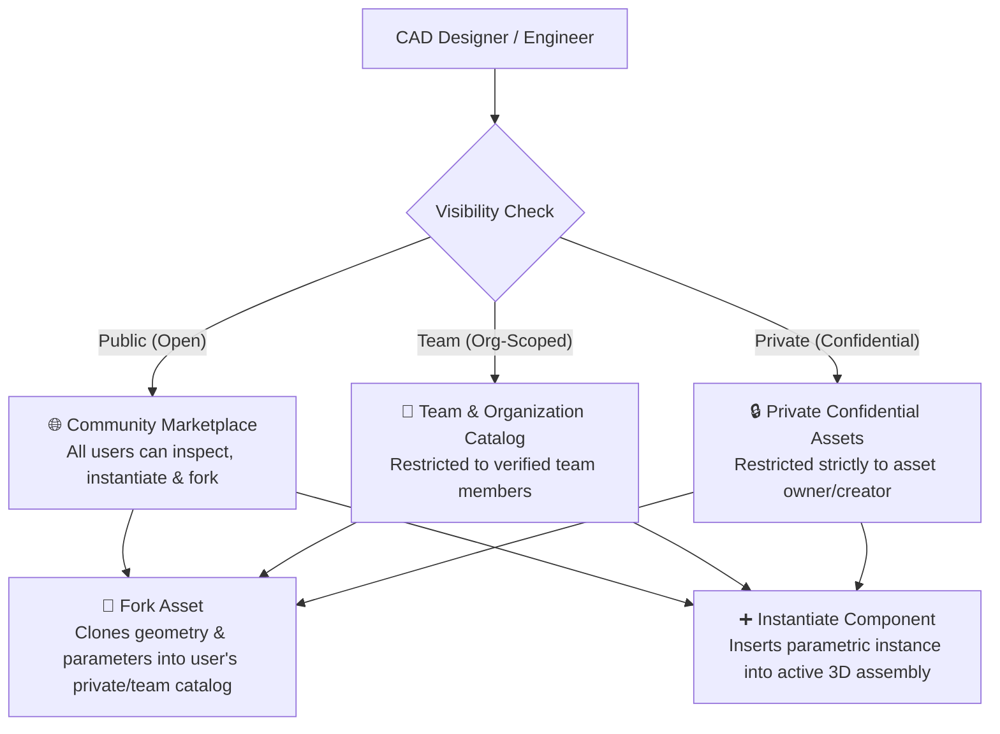
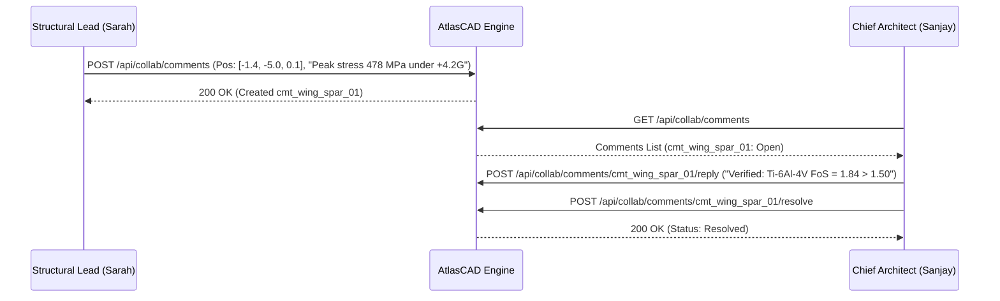

# AtlasCAD Multi-Tier Asset Ecosystem & Real-Time Collaboration Guide

This document specifies the technical architecture, access control policies, data contracts, and REST API endpoints for AtlasCAD's **Universal Asset Store & Component Hub** and **Real-Time Multi-User Collaboration Engine**.

---

## 1. Enterprise Value Proposition: Why AtlasCAD Beats Legacy CAD

Legacy CAD platforms (AutoCAD, Autodesk Inventor, SolidWorks) cost \$2,000 to \$5,000+ per user per year yet suffer from severe modern collaboration and asset sharing bottlenecks:
- **Siloed Content Centers**: Component libraries are locked in proprietary binary formats (`.dwg`, `.ipt`, `.sldprt`) or behind clunky Vault database servers requiring manual checkout and check-in.
- **No Git-Style Branching or Forking**: Engineers cannot fork another designer's component to build a private or team variant without breaking assembly dependencies.
- **Lack of Native Multi-User Presence**: Concurrent editing typically involves locking the entire file, preventing team members from reviewing, measuring, or annotating while a colleague is modeling.
- **No Direct 3D Spatial Annotation**: Review comments reside in external spreadsheets, emails, or PDF markups disconnected from the live 3D geometric coordinates.

**AtlasCAD solves these challenges with a modern, browser-accessible, local-first architecture**:
1. **Universal Multi-Tier Visibility**: Public Community Marketplace, Team/Organization Internal, and Private Confidential assets.
2. **Content-Addressed Parametric Assets**: Every asset carries an immutable content hash (FNV-1a / SHA-256), semantic versioning, and configurable parametric variables.
3. **1-Click Component Forking & Linked Instantiation**: Users can fork any accessible asset into their private workspace or instantiate it into their active assembly with linked dependency tracking.
4. **Live Presence & Optimistic Entity Leases**: Real-time avatar indicators, spatial cursor tracking, and entity-level locking prevent edit collisions while permitting simultaneous inspection and simulation.
5. **3D Spatial Review Pin Threads**: Design review notes are anchored directly to 3D Cartesian coordinates $[X, Y, Z]$ on the model surface with threaded discussions and approval states.

---

## 2. Multi-Tier Asset Model & Access Control



### 2.1 Visibility Tiers

| Tier | Enum Value | Access Rules | Ideal Use Cases |
| :--- | :--- | :--- | :--- |
| **Public** | `Public` | Universally readable, downloadable, and forkable by any authenticated or guest user. | Standard hardware (ISO/DIN fasteners, bearings, O-rings), open-source airframes, standard materials, robotic motors. |
| **Team** | `Team` | Accessible only to users belonging to the same Organization / Team (`caller.team_id == asset.author.team_id`). | Company internal standard brackets, proprietary fixtures, approved PCB enclosures, internal drawing templates. |
| **Private** | `Private` | Accessible strictly to the creator (`caller.user_id == asset.author.user_id`). Others receive `HTTP 403 Forbidden` or hidden. | Patent-pending inventions, confidential aerospace stealth nozzles, proprietary customer projects. |

### 2.2 Content-Addressable Asset Record Schema

```json
{
  "id": "ast_aero_waverider",
  "name": "Aerospace Supersonic Waverider",
  "description": "Parametric Mach 1.5–6.0 hypersonic waverider airframe with integrated scramjet inlet.",
  "kind": "CadGeometry",
  "category": "Aerospace",
  "version": "1.2.0",
  "visibility": "Public",
  "author": {
    "user_id": "usr_sanjay",
    "name": "Sanjay (Chief Architect)",
    "email": "sanjay@atlascad.internal",
    "team_id": "team_aero_structures",
    "avatar_color": "#6366f1"
  },
  "status": "UpToDate",
  "content_hash": "a4f89d31c0e2719a",
  "byte_size": 28450,
  "upstream_cad_id": "loft_body_waverider_01",
  "lod_level": "Lod0",
  "tags": ["aircraft", "supersonic", "waverider", "aerodynamics"],
  "parameters": [
    {
      "name": "mach_target",
      "param_type": "number",
      "default_value": "3.5",
      "min": 1.2,
      "max": 7.0,
      "unit": "M",
      "options": []
    },
    {
      "name": "wingspan_m",
      "param_type": "number",
      "default_value": "12.4",
      "min": 6.0,
      "max": 30.0,
      "unit": "m",
      "options": []
    }
  ],
  "downloads": 482,
  "stars": 94,
  "forked_from": null,
  "created_at": 1732280000,
  "updated_at": 1732280000
}
```

---

## 3. Real-Time Collaboration & Spatial Review Architecture

### 3.1 Live Presence & Spatial Cursor Synchronization

When multiple engineers work on a shared CAD assembly:
- Every client broadcasts a periodic heartbeat via `POST /api/collab/presence` carrying:
  - `user_id`, `name`, `role` (`Owner`, `Lead`, `Editor`, `Reviewer`, `Viewer`).
  - `cursor_pos`: 3D Cartesian coordinates $[X, Y, Z]$ where the user's cursor is hovering over the model.
  - `active_tool`: Tool currently armed (e.g. `3D Extrude`, `FEA Stress Inspector`, `Chamfer`).
  - `selected_entity`: ID of the face, edge, or body currently selected.
- The Studio topbar renders active collaborator avatars with glowing role indicators.

### 3.2 Optimistic Entity Leases & Conflict Prevention

Rather than locking the whole project file, AtlasCAD implements **fine-grained optimistic entity leases**:
- When User A edits a body or face, the client requests a lease via `POST /api/collab/lock`:
  ```json
  {
    "entity_id": "body_fuselage_01",
    "user_id": "usr_sanjay",
    "duration_sec": 30
  }
  ```
- If another user holds an unexpired lease, the server refuses with `acquired: false` and the holder's name.
- If granted, other collaborators see a colored outline and badge: *"Locked by Sanjay"*.
- When editing finishes or 30 seconds elapse without renewal, the lock automatically releases.

### 3.3 3D Spatial Pin Comments & Design Reviews

Engineers can click anywhere on the 3D model to place an engineering note:
- **Anchored in 3D Space**: Each comment records a 3D coordinate $[X, Y, Z]$ and an optional `entity_id`.
- **Review Threads**: Team members can reply to the thread, propose design revisions, and verify stress calculations.
- **Lifecycle States**: `Open` (yellow warning) $\to$ `Resolved` (green verified).



---

## 4. REST API Endpoint Reference

### 4.1 Asset Management

#### `GET /api/assets`
Lists assets matching permission, category, and search criteria.
- **Query Parameters**:
  - `visibility`: `public`, `team`, `private` (default: all permitted)
  - `category`: `Aerospace`, `Hardware`, `Robotics`, `Materials`, `General`
  - `q`: Search string matching title, description, tags, or author
  - `user_id`: Caller user ID (for private asset visibility)
  - `team_id`: Caller team ID (for team asset visibility)
- **Response**: Array of `AssetRecord` objects.

#### `GET /api/assets/:id`
Retrieves full asset details, parameters schema, and payload preview.
- **Response**: `{ "record": {...}, "data_preview": "...", "byte_size": 28450, "content_hash": "..." }`
- **Errors**: `404 Not Found` if missing; `403 Forbidden` if private asset belonging to another user.

#### `POST /api/assets`
Publishes an active model or part as a catalog asset.
- **Payload**:
  ```json
  {
    "name": "Titanium Elevon Hinge Bracket",
    "description": "Additive manufactured Ti-6Al-4V bracket.",
    "category": "Aerospace",
    "visibility": "team",
    "tags": ["hinge", "titanium", "additive"],
    "parameters": [...]
  }
  ```

#### `POST /api/assets/:id/fork`
Forks an authorized public or team asset into the caller's private or team catalog.
- **Payload**: `{ "user_id": "usr_sanjay", "visibility": "private" }`
- **Response**: Forked `AssetRecord` with `forked_from` reference.

#### `POST /api/assets/:id/use`
Instantiates an asset into the active project assembly with applied parameters.
- **Payload**: `{ "instance_name": "wing_hinge_left_inst", "parameters": { "pin_dia": 12.0 } }`
- **Response**: `{ "status": "Instantiated", "asset_id": "...", "downloads": 483 }`

---

### 4.2 Real-Time Collaboration

#### `GET /api/collab/presence`
Returns currently active collaborators and active entity locks.
- **Response**:
  ```json
  {
    "users": [
      {
        "id": "usr_sanjay",
        "name": "Sanjay (Chief Architect)",
        "role": "Owner",
        "avatar_color": "#6366f1",
        "cursor_pos": [0.0, 4.0, 1.2],
        "active_tool": "3D Extrude",
        "selected_entity": "body_fuselage_01"
      }
    ],
    "locks": [],
    "total_active": 3,
    "timestamp": 1732280000
  }
  ```

#### `POST /api/collab/presence`
Updates caller's presence state and broadcasts cursor position.

#### `POST /api/collab/lock`
Acquires or renews an entity lease.
- **Payload**: `{ "entity_id": "body_fuselage_01", "user_id": "usr_sanjay", "duration_sec": 30 }`
- **Response**: `{ "acquired": true, "lock": {...} }` or `{ "acquired": false, "reason": "Locked by Sarah", "expires_in_sec": 14 }`

#### `POST /api/collab/unlock`
Releases an entity lease.

#### `GET /api/collab/comments`
Retrieves all 3D spatial pin comments and thread replies.

#### `POST /api/collab/comments`
Creates a new 3D spatial annotation.
- **Payload**:
  ```json
  {
    "pos_3d": [0.0, 4.0, 1.2],
    "text": "Check fastener tolerance and O-ring seal groove.",
    "entity_id": "fuselage_nose_joint"
  }
  ```

#### `POST /api/collab/comments/:id/reply`
Appends a reply to an existing comment thread.

#### `POST /api/collab/comments/:id/resolve`
Toggles status between `Open` and `Resolved`.
