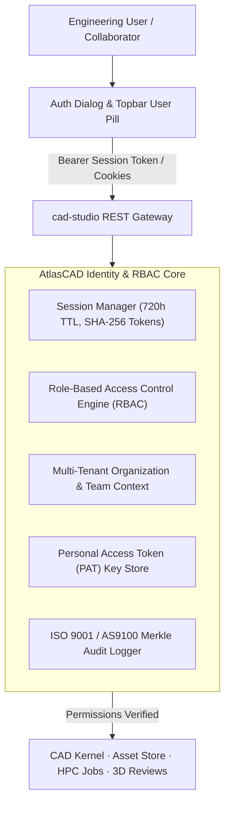

# Enterprise Identity, Authentication & Role-Based Access Control (RBAC)

AtlasCAD features a production-ready, enterprise-grade Identity & Authentication subsystem engineered for multi-tenant engineering teams, confidential defense/aerospace contractors, and commercial engineering SaaS deployments.

---

## 1. Authentication Architecture

AtlasCAD's identity layer connects local-first workstation ergonomics with commercial SaaS security governance.

### Key Capabilities:
- **Zero-Friction Role Switching**: 1-click test identities enable instant testing of different permission levels across `Chief Architect`, `Lead Engineer`, `Design Engineer`, and `Reviewer` roles.
- **Multi-Tenant Team Workspaces**: Seamless switching between operational teams (`team_aero_structures`, `team_propulsion`, `team_robotics`, `team_compliance`, `personal_sandbox`).
- **Personal Access Tokens (PAT)**: Headless developer API keys for Python SDK automation, automated CI/CD batch testing, and CAD container pipelines.
- **Enterprise SSO Support**: Standardized identity contracts for SAML 2.0, Microsoft Entra ID (Azure AD), Okta, and Google Workspace.
- **Integrated Audit Trail**: Every identity mutation, session token issuance, and team switch is anchored into the ISO 9001 / AS9100 cryptographic audit chain.

---

## 2. Enterprise Engineering Roles & Permissions Matrix

| Permission String | Description | Chief Architect (`usr_sanjay`) | Lead Engineer (`usr_elena`) | Design Engineer (`usr_marcus`) | Airworthiness Reviewer (`usr_sara`) | Guest / Viewer |
| :--- | :--- | :---: | :---: | :---: | :---: | :---: |
| `cad:read` | Read & inspect 3D models and 2D drawings | ✅ | ✅ | ✅ | ✅ | ✅ |
| `cad:mutate` | Add sketches, extrude, cut, revolve, modify parameters | ✅ | ✅ | ✅ | ❌ | ❌ |
| `cad:export` | Export STEP AP214, STL, DXF, 3MF, DaVinci, Unity | ✅ | ✅ | ✅ | ✅ | ❌ |
| `assets:publish_public` | Publish components to global marketplace | ✅ | ❌ | ❌ | ❌ | ❌ |
| `assets:publish_team` | Publish components to verified team catalog | ✅ | ✅ | ✅ | ❌ | ❌ |
| `assets:publish_private`| Save confidential components in private sandbox | ✅ | ✅ | ✅ | ❌ | ❌ |
| `collab:lease_locks` | Acquire optimistic entity leases on bodies/features | ✅ | ✅ | ✅ | ❌ | ❌ |
| `collab:comment` | Anchor 3D spatial review pins & threaded replies | ✅ | ✅ | ✅ | ✅ | ✅ |
| `collab:review_resolve`| Mark design review pins as `Resolved` / Closed | ✅ | ✅ | ❌ | ❌ | ❌ |
| `admin:manage_users` | Provision and de-provision organizational seats | ✅ | ❌ | ❌ | ❌ | ❌ |
| `admin:api_keys` | Generate and revoke Personal Access Tokens (PAT) | ✅ | ✅ | ❌ | ❌ | ❌ |
| `hpc:unlimited` | Bypass HPC simulation queue limits | ✅ | ❌ | ❌ | ❌ | ❌ |

---

## 3. Commercial SaaS Licensing ($2,000 / Year Tier)

AtlasCAD includes native validation and enforcement for the **$2,000 / Year Commercial Enterprise License**, delivering 10x economic value compared to legacy CAD vendors:

- **Compliant Enterprise License Key**: Cryptographically formatted license certificate (e.g. `ATLAS-ENT-2026-X889-K992-FLIGHT`).
- **Seat Allocation & Quotas**: 10 active concurrent engineer seats per team workspace, with real-time seat tracking.
- **Unlimited Advanced Features Included**:
  - Full 6-DOF Waverider Supersonic Aerodynamics Simulator with video capture.
  - Multi-tier Content-Addressable Asset Store (Public, Team, Private).
  - Optimistic entity leases and 3D spatial design review pins.
  - AS9100 / ISO 9001 Merkle audit chain with SHA-256 compliance hashing.
  - Unlimited STEP AP214, DXF, ASTM 3MF, and DaVinci Resolve OpenUSD exports.

---

## 4. REST API Reference

### Identity & Profile
- `GET /api/auth/me`: Returns current authenticated identity, active team, license status, seat usage, and organizational directory.
- `POST /api/auth/login`: Authenticate via user ID (quick-switch), email/password, or SSO provider token.
- `POST /api/auth/register`: Provision a new organizational seat with custom role and team assignment.
- `POST /api/auth/logout`: Invalidate session and transition to Guest Reviewer mode.
- `POST /api/auth/switch-team`: Dynamically switch the user's active engineering team workspace.

### Developer API Keys (PAT)
- `GET /api/auth/api-keys`: List active Personal Access Tokens.
- `POST /api/auth/api-keys`: Generate a new Personal Access Token with specific capability scopes (`cad:read`, `cad:mutate`, `sim:hypersonic`, `export:all`).
- `POST /api/auth/api-keys/revoke`: Immediately revoke an API key.

### Sessions & Security Audit
- `GET /api/auth/sessions`: List active concurrent sessions, IP origins, browser user-agents, and login timestamps.
