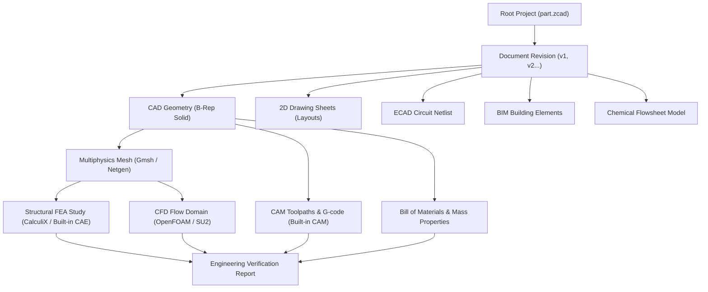

# AtlasCAD Unified Engineering Data Graph Architecture

## Overview
Engineering projects rarely consist of isolated 3D shapes. A real product connects CAD geometry to finite element meshes, fluid domains, circuit schematics, bill of materials, manufacturing toolpaths, compliance reports, and digital twin telemetry.

AtlasCAD implements a unified **Engineering Graph** that connects all multidisciplinary entities into a directed acyclic dependency graph (DAG).

---

## 1. Graph Node Hierarchy

---

## 2. Dependency Tracking & Stale Result Invalidation

### 2.1 The Stale Result Problem
In traditional disconnected engineering suites, modifying a CAD dimension (e.g. plate thickness $t = 10\text{ mm} \to 15\text{ mm}$) leaves previously calculated FEA stresses, CFD pressure drops, or CNC toolpaths silently out of sync. Users inadvertently manufacture parts based on obsolete simulations.

### 2.2 AtlasCAD Provenance Invalidation Engine
1. **Document Fingerprinting**: Every model mutation generates a cryptographically hashed revision identifier $H(\text{model})$.
2. **Result Tagging**: Simulation results, meshes, drawings, and toolpaths store the exact source revision hash $H_{\text{source}}$.
3. **Stale Flagging**: If $H(\text{current}) \ne H_{\text{source}}$, the dependency graph marks downstream nodes as **`STALE`**:
   - WebGL Viewport displays an alert banner: `⚠️ Results Stale — Model Modified (REV 2 vs REV 1)`.
   - Toolpaths refuse export until rebuilt or acknowledged.
   - Drawing sheets flag unassociated dimensions with orange review clouds.
