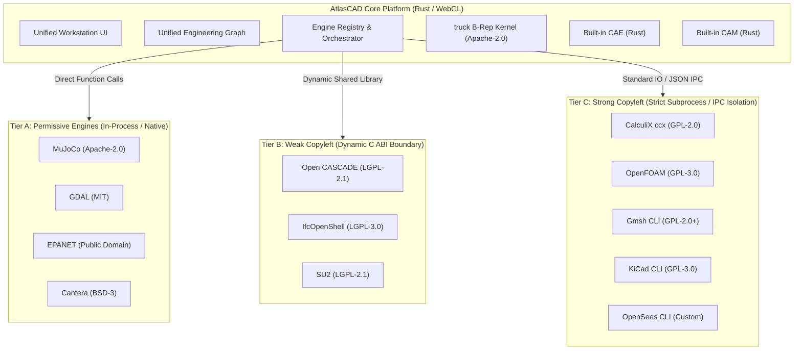

# AtlasCAD License & Attribution Audit

## Executive Summary
This document classifies every evaluated upstream engineering engine by license tier and specifies the legally compliant architectural isolation boundary required by AtlasCAD.

---

## 1. License Classification Categories

| Category | Description | Permitted Integration Model in AtlasCAD | Examples |
| :--- | :--- | :--- | :--- |
| **Tier A: Permissive** | MIT, Apache-2.0, BSD-2-Clause, BSD-3-Clause, ISC, Public Domain/CC0 | Direct Rust crate compilation, static linking, embedding in core binary | truck, MuJoCo, GDAL, EnergyPlus, pandapower, OpenDSS, Cantera, RDKit, EPANET, SWMM, MODFLOW |
| **Tier B: Weak Copyleft** | LGPL-2.1, LGPL-2.1 with exception, LGPL-3.0 | Dynamic linking (`dlopen`), standalone shared libraries (`.so`/`.dylib`), C ABI boundary with clean relinking | Open CASCADE (OCCT), Netgen, SU2, IfcOpenShell, JSBSim, FEniCSx |
| **Tier C: Strong Copyleft**| GPL-2.0, GPL-3.0 | **Mandatory Process Isolation**: Subprocess execution via typed JSON/IPC, CLI adapters, containerized background workers. **Never statically linked or in-process compiled into core AtlasCAD binary.** | CalculiX (`ccx`), OpenFOAM, Gmsh, SolveSpace, KiCad, OpenSees, DWSIM, OpenRocket, LAMMPS |
| **Tier D: Network Copyleft**| AGPL-3.0 | Isolated network service with explicit user opt-in | Palabos |
| **Tier E: Specialized** | NASA Open Source Agreement (NOSA 1.3) | Process isolation via command-line interface | OpenVSP |

---

## 2. Upstream Compliance & Isolation Matrix

---

## 3. Software Bill of Materials (SBOM) & Attribution Notice

AtlasCAD generates and maintains a CycloneDX 1.5 JSON SBOM (`engineering/sbom/atlascad.cdx.json`). All upstream projects are credited with copyright notices preserved in `dist/NOTICE.txt` and accessible in the client via `HELP` $\to$ `About AtlasCAD & Open Source Licenses`.
